# Assessment Bot

**A tool designed by a Digital Technology and Computer Science teacher to simplify tracking and assessing the work of hundreds of students.**

**[Read the Documentation Here](./docs/README.md)**

Assessment Bot automates routine checking and scoring, so teachers can spend more time acting on the insights to improve learning.

This tool pulls Google Slides from Google Classroom assignments and evaluates them on **Completeness**, **Accuracy**, and **SPaG** (Spelling, Punctuation, and Grammar), scoring each out of 5.

- [Assessment Bot](#assessment-bot)
  - [Key Features](#key-features)
  - [The Browser App](#the-browser-app)
    - [Create a new assessment](#create-a-new-assessment)
    - [Classes overview](#classes-overview)
    - [Run a new assessment](#run-a-new-assessment)
    - [Assignments page](#assignments-page)
    - [Task Heatmap](#task-heatmap)
    - [Cell-level evidence](#cell-level-evidence)
    - [Heatmaps builder](#heatmaps-builder)
  - [How It Works](#how-it-works)
  - [Privacy and Security](#privacy-and-security)
  - [What Can It Assess?](#what-can-it-assess)
  - [Is It Perfect?](#is-it-perfect)
  - [Setup](#setup)
  - [Contributing](#contributing)
  - [Why Use This Tool?](#why-use-this-tool)

---

## Key Features

- **Automated Assessment**: Quickly evaluates student submissions against a reference and template.
- **Customisable Marking**: Identify key elements for assessment using Alt Text markers:
  - `#` for text or tables
  - `~` or `|` for images
- **Visual Feedback**: Provides a colour-coded task heatmap so you can see at a glance who is on track and who needs help.
- **Detailed Reporting**: Presents a class-level overview plus per-task breakdowns with:
  - Student scores (Completeness, Accuracy, SPaG)
  - Cell-level evidence: click any cell to see the AI reasoning and the student's original response
  - Performance averages across assignments
- **Quality assurance**: A department-wide Quality Assurance view is in development.

---

## The Browser App

The browser app is where you administer assessments and view results. The screens below show each step.

### Create a new assessment

The end-to-end happy path: from a class page, kick off a new assessment, and walk the wizard to define the assessment.

**1. Open the class page and click "Start New Assessment".**

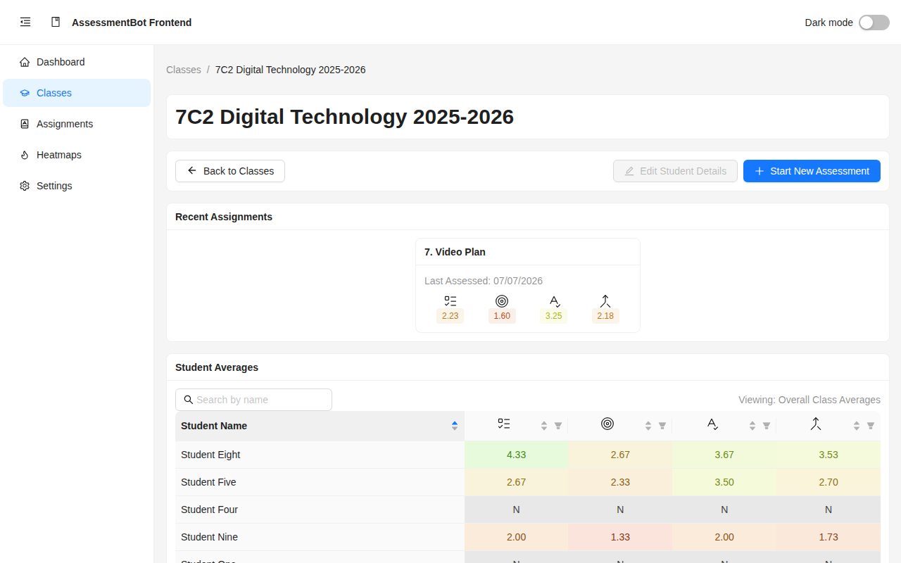

**2. Pick the Google Classroom assignment to assess.**

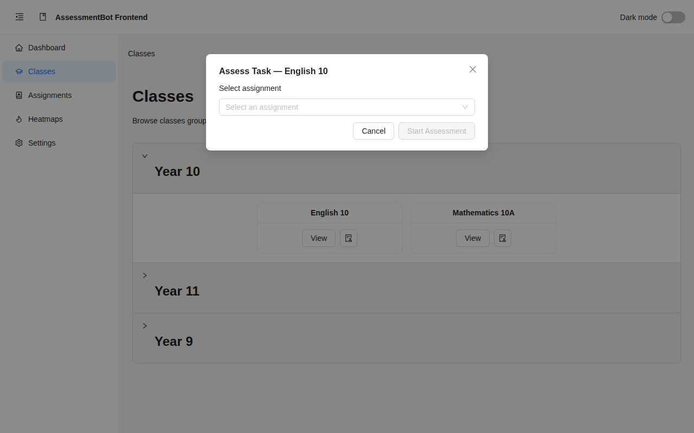

**3. Fill in the wizard — title, topic, year group, and the reference/template document URLs.**

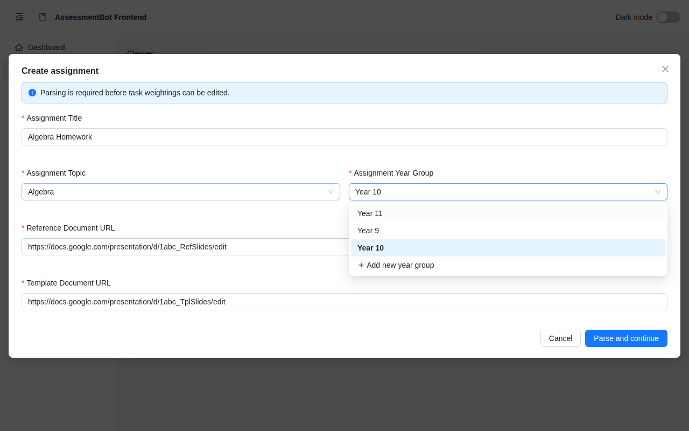

**4. The tool parses the documents, surfaces the extracted tasks, and you save.**

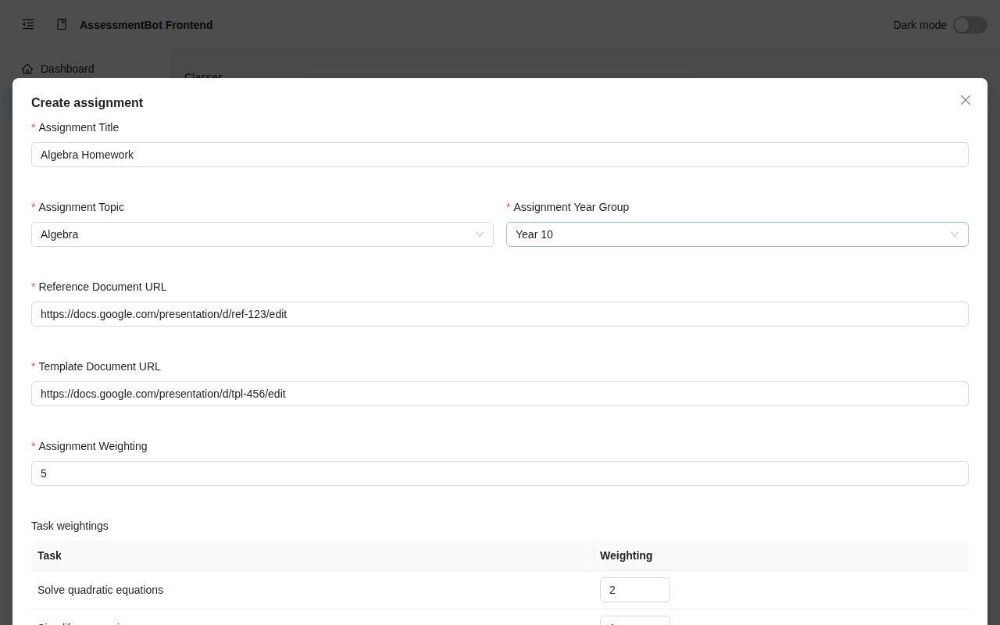

### Classes overview

Classes are grouped by year group, with each card offering one-click access to the class page and to a fresh assessment run.

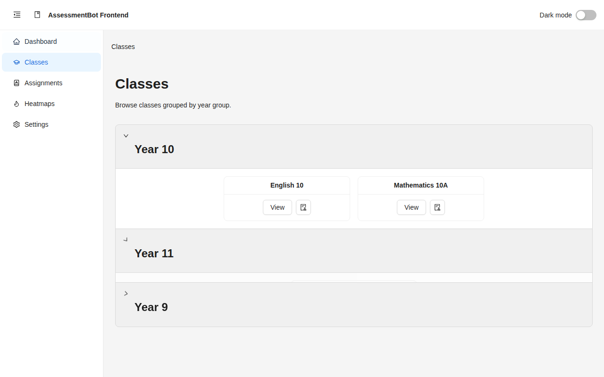

### Run a new assessment

Pick a Google Classroom assignment, kick off the run, and either create a new assignment definition inline or link to an existing one.

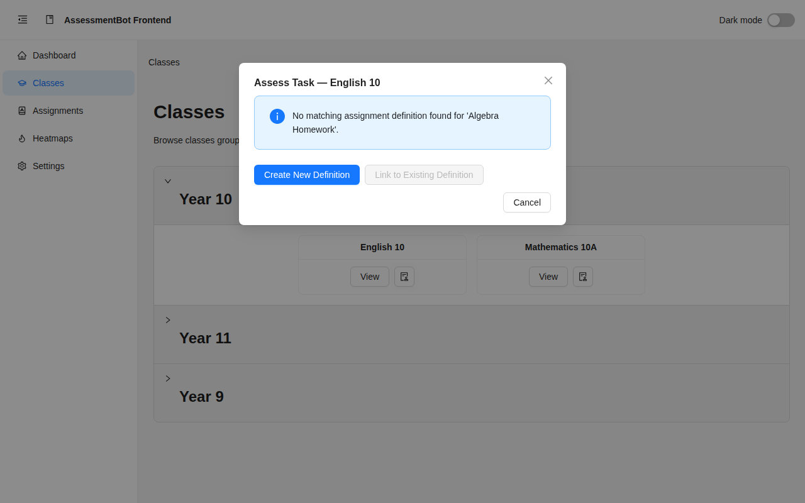

### Assignments page

Every assignment definition is listed in one table. Filter, sort, update, or permanently delete obsolete entries from the same surface.

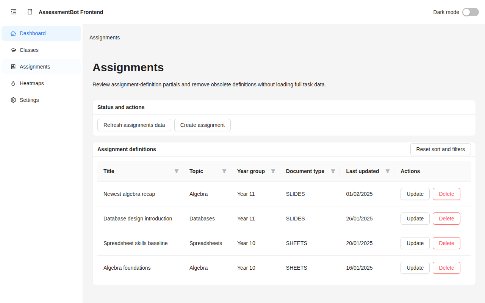

Destructive actions are confirmed in a dedicated dialog so accidental clicks never silently lose work.

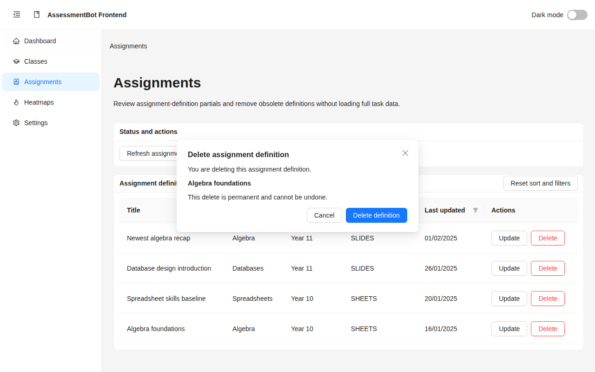

### Task Heatmap

The per-class detail page exposes a per-task, per-student heatmap. Each task is broken into Completeness, Accuracy and SPaG sub-columns, with banded colour coding that surfaces who is on track and who needs support at a glance.

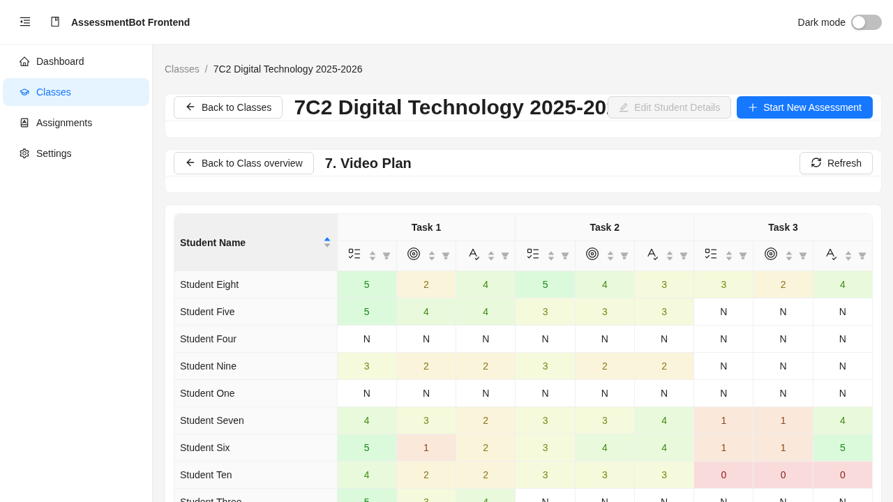

### Cell-level evidence

Every heatmap cell is a button. Click it to inspect the AI's reasoning alongside the student's actual work — in whatever form the student produced it: an image of a slide, a text response, or a table.

<table>
  <tr>
    <td>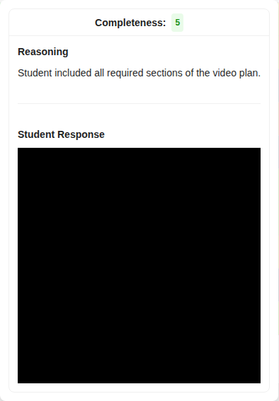</td>
    <td>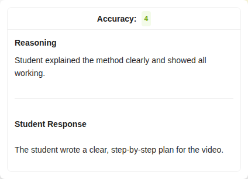</td>
    <td>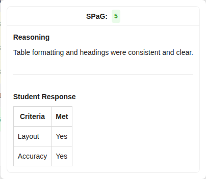</td>
  </tr>
  <tr>
    <td align="center"><b>Image</b> Slide captures and diagrams</td>
    <td align="center"><b>Text</b> Markdown reasoning</td>
    <td align="center"><b>Table</b> Rendered tabular data</td>
  </tr>
</table>

### Heatmaps builder

Build a cross-assignment heatmap by picking a class, a topic, and the assignments to merge. The same per-cell evidence flow is available on the merged table.

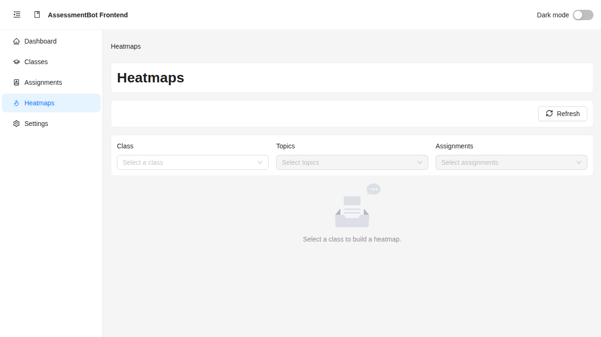

---

## How It Works

1. **Preparation**:
   - Create a **perfect reference** with all tasks completed correctly.
   - Provide a **blank template** for students to complete.
2. **Marking Tasks**: Use Alt Text markers (e.g. `Task 1 – Do this thing`) to identify the parts to assess.
3. **Assessment**:  
   The tool pulls student submissions from Google Classroom and uses Mistral's
   `mistral-small-latest` model to:
   - Compare submissions to the reference
   - Score based on Completeness, Accuracy, and SPaG
   - Validate spreadsheet formulae and provide visual feedback
4. **Reporting**:  
   Results are compiled into a colour-coded heatmap in the web app. The results include:
   - Individual scores
   - Work previews
   - Class-wide averages

---

## Privacy and Security

The tool is designed to limit how long student data is kept. These are the controls in place:

- **Controlled data sharing**: The tool retrieves data from Google Workspace and sends only
  the assessment payload to the configured LLM service. The educational institution controls
  that service. For the service's provider and retention details, see the
  [Assessment Bot LLM Service repository](https://github.com/h-arnold/AssessmentBot-LLM-Service).
- **Mitigations against accidental PII exposure**: Uploaded images are held only while an
  assessment is being processed. The [service repository](https://github.com/h-arnold/AssessmentBot-LLM-Service)
  documents how the service handles data and which model it uses.
- **FOSS Transparency**: The entire tool, including the Assessment Bot LLM Service, is
  **free and open-source software (FOSS)**. You can inspect the source in the
  [service repository](https://github.com/h-arnold/AssessmentBot-LLM-Service).

By design, this tool minimises any long-term storage of student data and maintains a secure, private workflow.

---

## What Can It Assess?

The tool works with:

- **Text**
- **Tables** (converted to Markdown for easier processing)
- **Slide Images**
- **Spreadsheets** (including formula checking with visual feedback)

It’s been tested successfully on:

- **Factual content**
- **Block code** (e.g., MakeCode for Microbit)
- **Basic persuasive writing**
- **Posters** (with a view to assessing the application of design principles)
- **Spreadsheet tasks** (with formula validation and formatting)

---

## Is It Perfect?

Not quite. While **LLMs aren’t infallible**, the tool is reliable enough to provide a snapshot of:

- Who’s on track
- Who needs extra support

It’s still up to you to address misconceptions and motivate students.

---

## Setup

The initial set up should take no more than an hour, including deploying the backend and creating all the Assessment Records.

Check out the [docs](./docs/README.md) for more details.

---

## Contributing

See [CONTRIBUTING.md](./CONTRIBUTING.md) for the full developer guide.

Contributions are very welcome!  
If you have ideas, improvements, or bug fixes, feel free to open a **Pull Request (PR)**.

Some areas we’d particularly appreciate help with:

- Improving setup simplicity
- Expanding documentation
- Refining the Quality Assurance view

---

## Why Use This Tool?

- Save time while managing hundreds of students.
- Get actionable insights at a glance.
- Use it for everything from basic content checks to QA-ready reporting.

Feedback and contributions are welcome.
