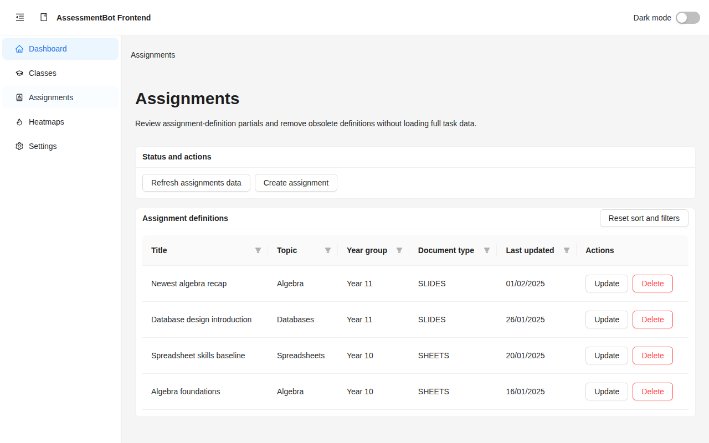
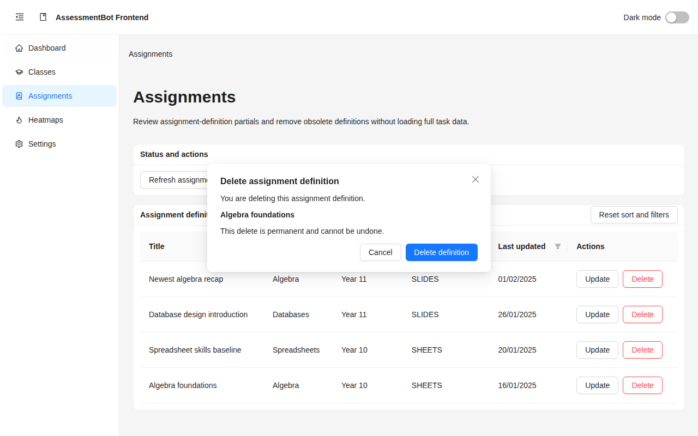

# Manage assignment definitions

An assignment definition stores the reference and template URLs and the task weightings for
an assignment. The **Assignments** page lists the definitions for your organisation.

## Find a definition

1. Open **Assignments**.
2. Use the column filters to narrow the list, for example by title, topic or year group.
3. Select **Reset sort and filters** to clear them.

## Create a definition

Select **Create assignment** to open the same wizard described in
[Run an assessment](../run-an-assessment/index.md).

## Update a definition

Select **Update** in the row's **Actions** column, then change the details and save.

## Delete a definition

1. Select **Delete** in the row's **Actions** column.
2. Read the confirmation, which names the definition.
3. Select **Delete definition** to confirm.

Deleting a definition is permanent and cannot be undone.

## Related guides

- [Run an assessment](../run-an-assessment/index.md) — link to an existing definition when
  starting a marking run.
- [View results](../view-results/index.md) — read the scores a definition produced.
