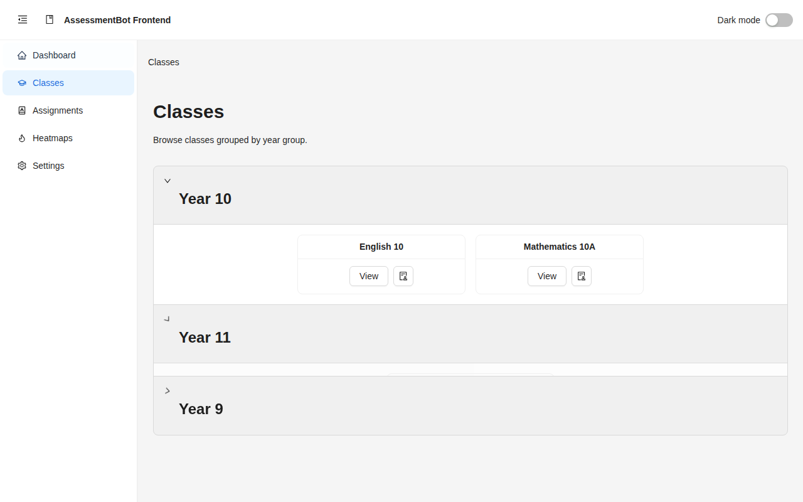
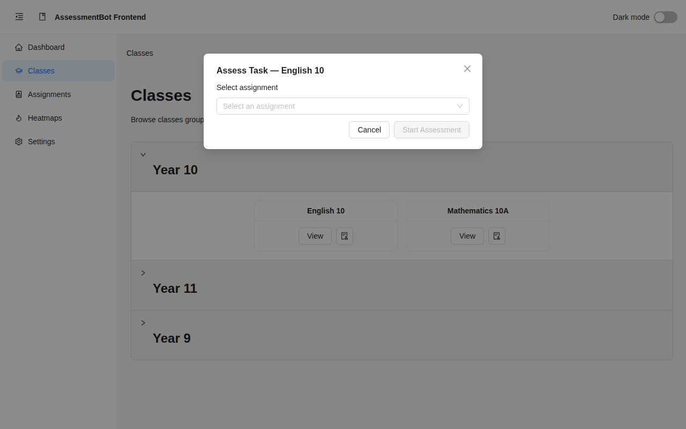
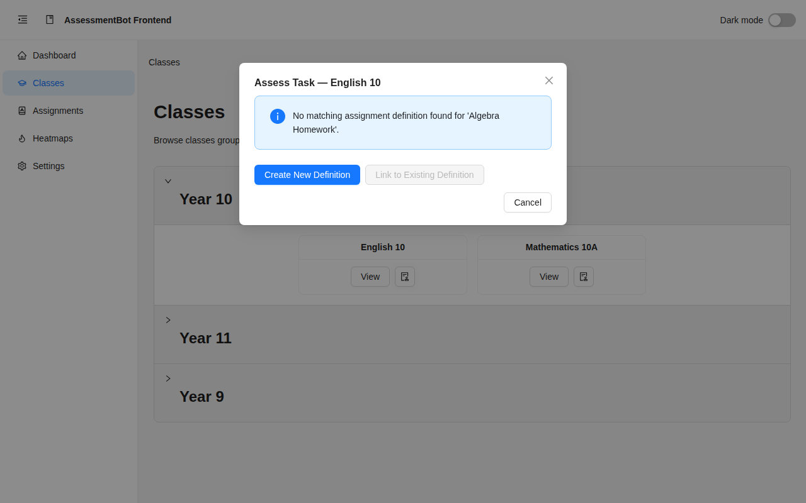
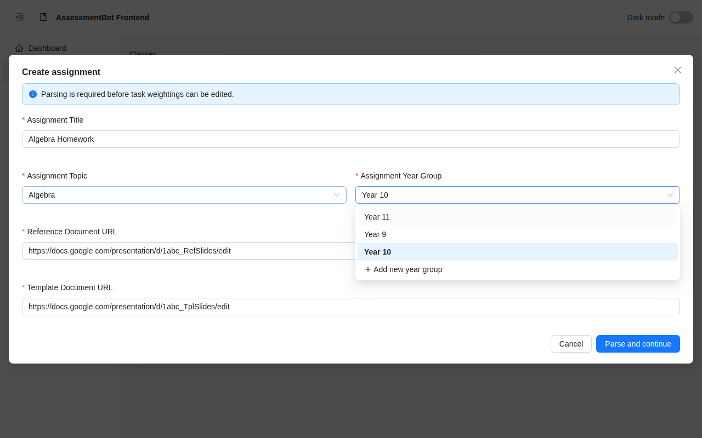
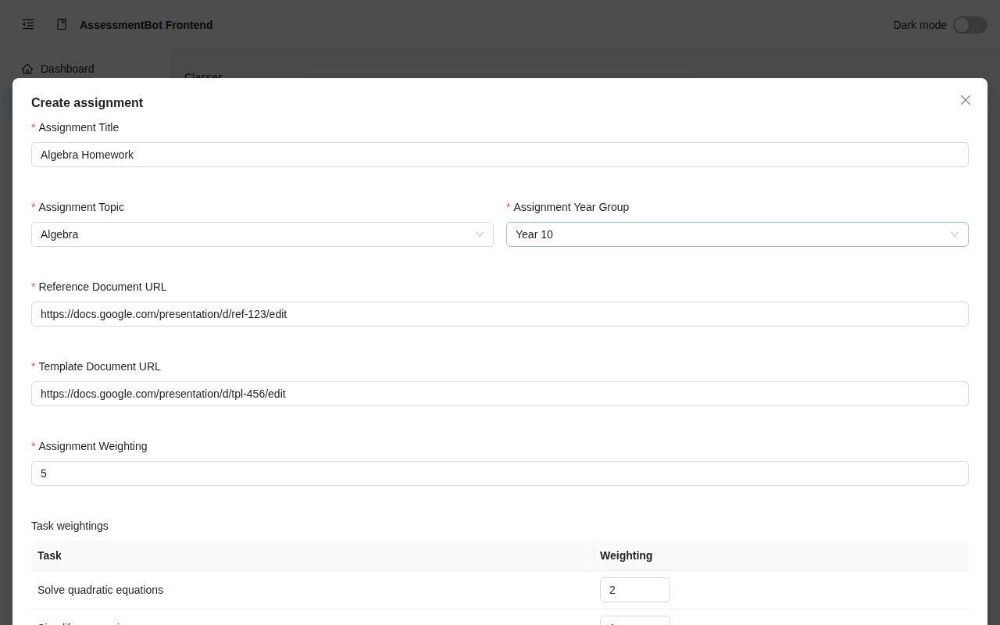

# Run an assessment

Assessment Bot compares students' work with your reference document and scores each task.

## Before you start

Have these ready:

1. A tagged template attached to a Google Classroom assignment.
2. Reference slides or a reference sheet that would score `5` for completeness, accuracy
   and SPaG.
3. The full sharing URLs for both documents. Copy each URL from the address bar; it starts
   with `https://docs.google.com/`. A bare document ID is not accepted.

Students must have completed at least part of the task.

## What is an assignment definition?

An assignment definition stores the reference and template URLs and the task weightings for
an assignment. Assessment Bot reuses a definition when the assignment title, topic and year
group all match. Name assignments consistently across your department so definitions can
be reused.

## Start the assessment

1. Open Assessment Bot and select **Classes**.
2. On the class card, select the **Assess Task** icon.
3. Choose the Google Classroom assignment from **Select assignment**.
   
4. Select **Start Assessment**.

If a definition matches, the run starts straight away. Skip to [Wait for the run](#wait-for-the-run).

If no definition matches, a choice prompt appears.

### Create a new definition

1. Select **Create New Definition**.
2. Enter the assignment title, topic and year group, then paste the reference and template
   URLs.
   
3. Select **Parse and continue**.
4. Check the parsed tasks and their weightings.
   
5. Select **Save**. The assessment starts automatically.

### Link to an existing definition

1. Select **Link to Existing Definition**. The button is disabled when no definition exists
   for the class's year group.
2. Choose a definition from the list.
3. Select **Link**. The assessment starts automatically.

## Wait for the run

The run usually takes 2 to 10 minutes. Image tasks take longer than text or table tasks.

## Check the result

When the run completes, open the class page or the **Assignments** page. See
[View results](../view-results/index.md) for what the scores mean.

For an explanation of how weightings affect averages, see
[How Assessment Bot calculates scores](../../pedagogy/data-analysis-scoring.md).
