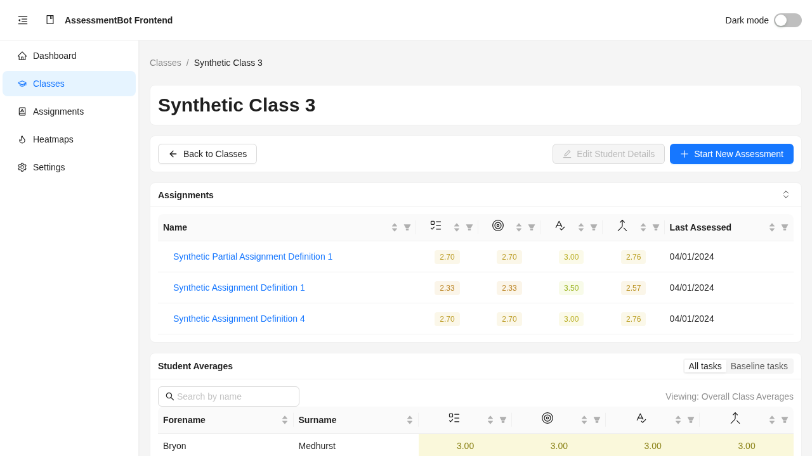
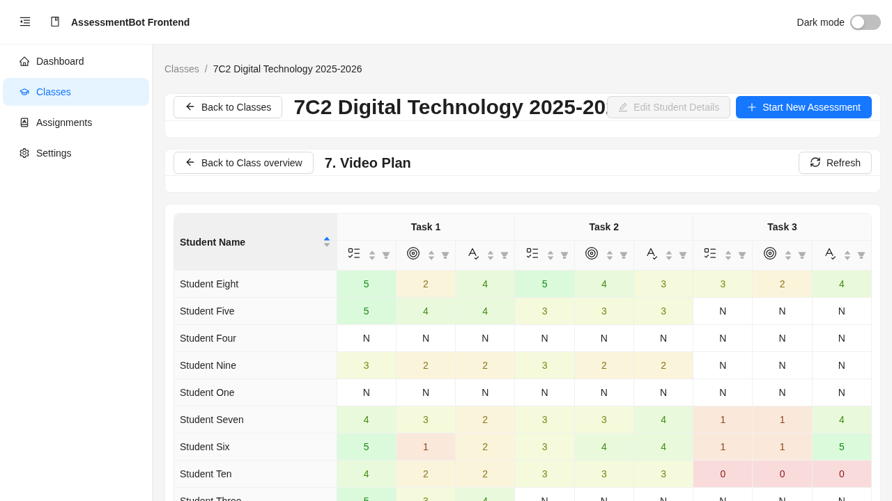
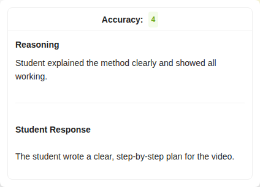
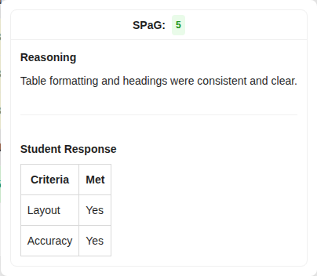
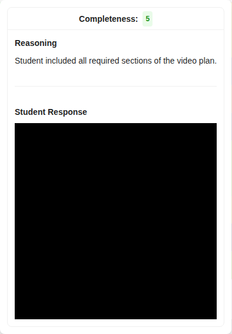
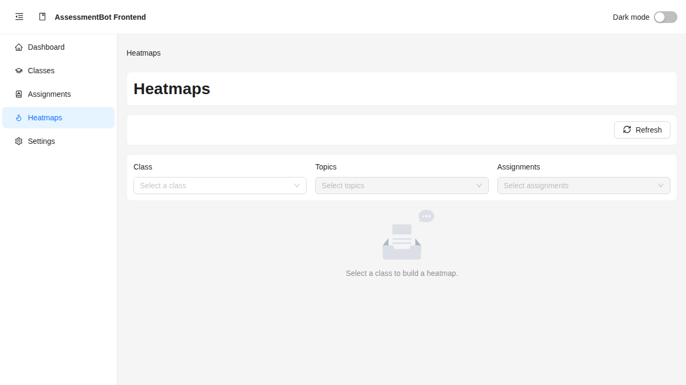

# View results

Results appear on the class page and on the heatmap surfaces. The numbers are explained in
[How Assessment Bot calculates scores](../../pedagogy/data-analysis-scoring.md).

## Class page

Open **Classes**, then select **View** on a class.

- **Assignments** lists every assignment with columns for **Name**, **Completeness**, **Accuracy**, **SPaG**, **Average** and **Last Assessed**. Each column heading has controls to sort or filter it. It shows the three most recent assignments at first; when you have more, **Show all assignments** at the top-right of the card displays them, and **Show fewer assignments** returns to three. Select an assignment's name to open its heatmap.
- **Student Averages** shows the weighted averages for every student.

Use the search box to find a student.

## Assignment heatmap

Open an assignment from the class page to see a grid of students against tasks.

Cell colour shows the score band. `N` means the work was not attempted or was not
applicable. Each column heading has controls for sorting and filtering.

## Task previews

A task preview shows the score, the reasoning and the student's response for one task.

## Heatmaps page

The **Heatmaps** page builds a heatmap across classes, topics and assignments. Choose a
class to begin.

The **Averages basis** control on the class page changes which tasks feed its averages. It
does not change individual task scores. See
[Averages basis: all tasks or baseline tasks](../../pedagogy/data-analysis-scoring.md#averages-basis-all-tasks-or-baseline-tasks).
