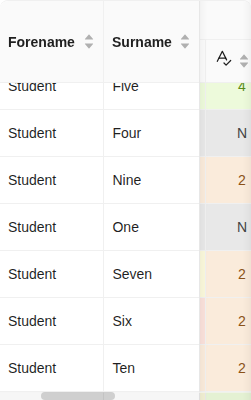
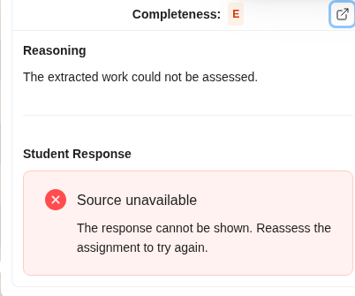

# 🚀 v1.2.0

Assessment Bot v1.2.0 builds on the v1 Web App with a new baseline analysis mode, easier heatmap selection, clearer error messages and more dependable data handling. It also records class metadata after analysis, laying the groundwork for broader data visualisations.

## ✨ Highlights

- **Baseline task analysis.** A new **Averages basis** control offers **Baseline tasks** alongside averaging across all tasks. Baseline mode averages scores against the tasks attempted by the top 10% most-engaged students in the class (minimum two), so a task that a teacher skips for the whole class no longer drags the average down. It needs at least three students and two who attempted a task; the option is disabled with an explanation when that data is unavailable.
- **Select all on the Heatmaps page.** The Topics and Assignments dropdowns now include **Select all** and **Select none** controls. Select all adds the options currently shown to the selection without removing anything already chosen, and respects the active topic filter and search text.

- **Horizontal scrolling with frozen name columns.** The Student Averages table, class heatmaps and the standalone Heatmaps page keep Forename and Surname pinned while you scroll through tasks. The header stays in place and the heatmap uses the full page width.

- **Clearer errors in task previews.** When a response cannot be displayed, the heatmap now shows an inline **Source unavailable** alert explaining how to proceed while keeping the recorded reasoning visible. Known errors no longer collapse the whole preview into a loading or generic failure state, and genuinely missing submissions are still reported without an error.

- **Class metadata for future analysis views.** ABClass records now carry a validated `metadata` snapshot of class-wide averages and recent assignments. A post-analysis task writes it after a successful averaging run, giving later data visualisations a durable summary to draw on.
- **More context above task heatmaps.** Completeness and accuracy summary cards now appear above the heatmap, and results from legacy assignments are displayed with a **Reassessment required** tag where appropriate.

## 🛠️ Reliability and maintenance

- **Null values are preserved in backend payloads.** Unset fields are emitted explicitly as `null` rather than dropped from read responses, and date conversion no longer flattens nulls or plain objects. Frontend transport schemas now accept these values.
- **Fewer lock failures when saving class partials.** `loadClass` now skips rewriting the roster when it already matches both stored records, removing the redundant write to the shared `ab_class_partials` registry that caused most concurrent-write lock failures.
- **Corrupt records are isolated on read.** Class and assignment reads validate each submission once and mark corrupt items without failing the whole read.
- Updated the vendored JsonDbApp dependency to v0.3.1 and resolved npm audit vulnerabilities.
- Continued strengthening regression coverage across analysis, heatmap, assessment and class workflows.

## 🧾 Changelog summary

- **Feature:** added baseline task analysis, select-all heatmap controls and class metadata written after analysis.
- **Feature:** added completeness and accuracy summaries above task heatmaps and displayed legacy assignment results.
- **Fix:** kept name columns frozen while heatmaps scroll horizontally and replaced whole-preview loading states with explicit, actionable error messages.
- **Reliability:** preserved null values in payloads, reduced class-partials lock contention and isolated corrupt records on read.
- **Maintenance:** updated JsonDbApp and dependencies, and extended automated regression coverage.
